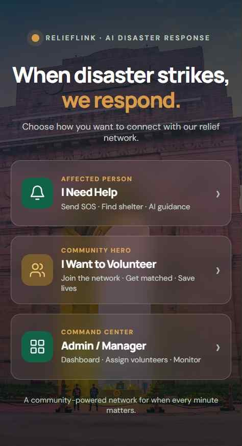
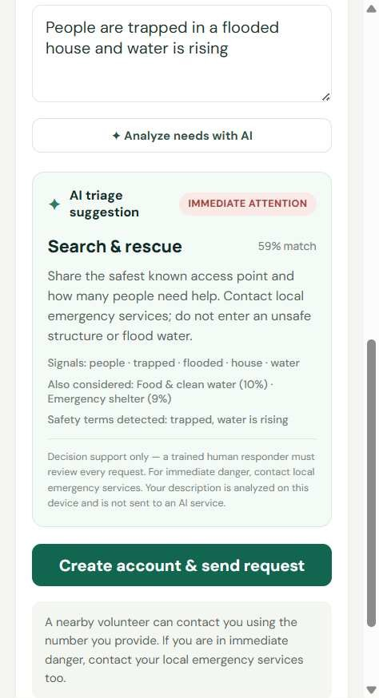

# ReliefLink — AI-assisted disaster response

ReliefLink is an accessible disaster-response prototype connecting affected people, local volunteers, and a response coordinator. It turns a plain-language help request into an explainable, offline AI triage suggestion so a human responder can prioritize and route it.

> **Prototype and safety notice:** this release stores accounts, sessions, volunteers, and requests in the current browser's `localStorage`. It is a functional single-browser demo, **not** a shared, production emergency-dispatch service. Different devices/browsers do not share data. Do not enter real personal or emergency information; contact local emergency services in an actual emergency. The classifier is decision support only and must never replace a trained human responder.

## Try it

Requirements: Node.js 18 or later. No package installation or API key is required.

```bash
npm start
```

Open [http://localhost:3000](http://localhost:3000). For the command-center demo, choose **Admin / Manager** and sign in with:

- Email: `admin@relieflink.pk`
- Password: `relief123`

Register an affected-person account and submit a sample request, then register a volunteer in the same browser to accept and resolve it. Admin can review the request, see the AI triage explanation, and assign it to a registered volunteer. Use **Analyze needs with AI** on the help form to see triage before submitting. The demo's seeded admin credential is public and is not suitable for a real deployment.

Run the automated model tests with:

```bash
npm test
```

## Problem and solution

During a disaster, a response team may receive urgent, unstructured requests across a community while having limited time to route them. ReliefLink provides one simple request flow and a coordinator dashboard. Its on-device classifier suggests a request category, likely volunteer skill, matching terms, priority indicators, and a cautious response prompt. People can edit their request, volunteers can accept and resolve work, and coordinators can assign registered volunteers.

## AI methodology

- **Model:** project-authored, in-browser Multinomial Naive Bayes text classifier with Laplace smoothing and a tempered softmax-style relative match score.
- **Training examples:** small, hand-written synthetic English and Roman Urdu example phrases embedded in [`triage.js`](./triage.js). No external dataset is used. The model is deterministic, inspectable, and runs without a network or AI API.
- **Outputs:** one of six need categories (medical/first aid, search and rescue, food and water, shelter, essential supplies, emotional support), two alternative categories, matched input tokens, a relative match score, and suggested volunteer skill.
- **Safety layer:** transparent high-risk phrase checks can flag an immediate-attention request; the user may also mark any request urgent. These phrase checks are simple rules, not a second ML model. Suggestions ask users to contact local emergency services for immediate danger and avoid giving a diagnosis or treatment instructions.
- **Limitations:** this is a small prototype model, not clinically validated, not calibrated for real-world probabilities, and not trained on representative disaster data. It can misunderstand slang, spelling, languages, context, and rare events. The confidence is a relative ranking signal—not a probability that a category is correct. A human must review every recommendation.
- **API/model usage:** no third-party AI API, hosted model, or external data service is called. Text classification happens locally in the browser. Google Fonts and the decorative Unsplash background are optional visual assets; core app and model logic require no API key.

## Technology

Vanilla HTML, CSS, and JavaScript; Node.js built-in HTTP server; browser `localStorage`; Web Crypto PBKDF2-SHA-256 password hashing; Node.js built-in test runner. There are no runtime package dependencies.

## Screenshots

Captured from the running application:





## Deployment

The static app can be imported into Vercel from this repository; `vercel.json` adds baseline response headers. To publish on GitHub Pages, run `npm run build`, then configure the repository's **Settings → Pages → Deploy from a branch → `main` / `/docs`**. The project page URL is `https://a3thonix.github.io/relieflink-ai-disaster-response/` once Pages is enabled. Rebuild and push the generated `docs/` files after source changes.

Deploying the static files does **not** add shared persistence or production authentication: browser storage remains isolated per visitor. Before using it as a real community service, add a secured backend/database, server-side authentication and authorization, abuse controls, privacy/retention policy, emergency-response partners, and operational monitoring. No real emergency should depend on this prototype.

## Team and contributions

- **A3thonix / project owner:** repository owner and prototype author; confirm the correct participant name and add any actual team members and their specific contributions before submission. No unverified contributors are listed.
- **AI coding assistance:** used during implementation; the project owner is responsible for reviewing, testing, and explaining the submitted code, as required by the hackathon rules.

## Hackathon submission checklist

- [x] Working local product and public-source-ready repository
- [x] Meaningful, demonstrable AI/ML component with methodology and limitations documented
- [x] Setup instructions and an end-to-end demo flow
- [x] Genuine product screenshots
- [ ] Deploy a judge-accessible live link and verify it
- [ ] Capture genuine screenshots and a short demo video
- [ ] Confirm participant/team names and their contributions
- [ ] Submit the product link, demo, description, and repository using the official form

The deployed URL, demonstration video, and actual team details must be verified and supplied by the project owner; they are deliberately not invented here.

Official rulebook: [NYLP AI Hackathon 2026](https://nylp-hackathon-rulebook.lovable.app/#welcome) · Submission form: [Tally](https://tally.so/r/D4rpdZ).
